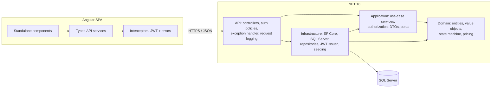
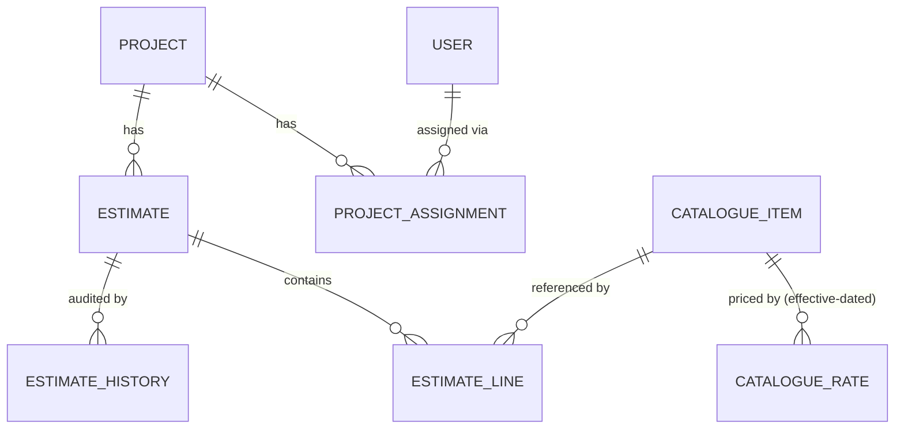
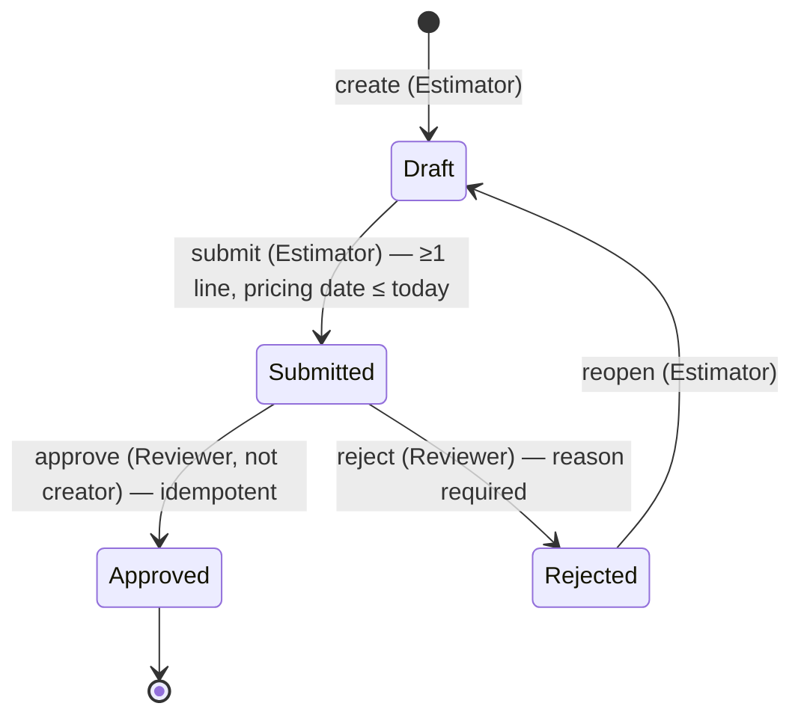

# Construction Estimator — Design

## 1. The problem in my own words

An estimate is a priced bill of quantities that becomes the **commercial record** for a
project once approved. Its value is not "whatever the catalogue says today" — it is what the
catalogue said on the estimate's *pricing date*, frozen at the moment each line was priced.
So the core of the system is reproducible money: every amount derivable from stored
inputs, rounded the same way every time, and never silently re-priced.

The second concern is **control**. An estimate moves through a small lifecycle
(Draft → Submitted → Approved/Rejected) and the value of that lifecycle is that it cannot be
bypassed, replayed or performed by the wrong person. Most of the authorisation is not
"which role are you" but "what is your relationship to *this* data": are you assigned to the
project, did you create the estimate, are you allowed to see the labour component of a rate.
Those rules must live on the server; the UI only reflects capabilities the server computed.

The third concern is **scale**. A real estimate has up to 50 000 lines. That rules out the
textbook "load the aggregate, mutate, save" approach for line edits, and it rules out
returning the whole estimate as one JSON document. The design has to keep the invariants
while touching one line at a time.

## 2. Assumptions, ambiguities and questions

Each item: what I found → what I decided → what I would have asked.

### 2.1 Things that do not hold together

**A1. R10 contradicts R11, and R11/R17 use a role R14 does not define.**
R10 says an approved estimate *cannot be changed*; R11 says a project manager can change its
description *at any time*. R14 defines exactly three roles, none of which is "project manager".
- **Decision:** Add `ProjectManager` as a fourth role (a deliberate, flagged deviation from R14).
  Re-read R10 as "the **commercial content** of an approved estimate cannot be changed":
  lines, quantities, rates, markups, pricing date, totals and status. The description is
  metadata. Only a ProjectManager may correct it, in any status, the correction never changes
  status or money, and it is audited with the old and new value (so the record stays
  trustworthy even though one field moved).
- **Question:** Is PM a separate role or a per-project responsibility held by e.g. a Reviewer?
  Should a correction on an approved estimate require a reason?

**A2. R16 is unreachable under R15 with fixed roles.**
Only Estimators create estimates (R15), only Reviewers approve. With one fixed role per user,
a reviewer can never be the creator, so R16 would be dead code.
- **Decision:** R16 is checked against the estimate's `CreatedById`, never against the current
  role. It becomes live when a user's role changes over time (an estimator promoted to
  reviewer) or if roles become per-project later. Seed data includes a submitted estimate
  created by `reviewer1` (documented as "created while reviewer1 was an estimator") so the
  rule can be demonstrated. Rejecting your own estimate is **allowed** — R16 only forbids
  approval, and rejection carries no self-dealing risk.
- **Question:** Should the rule be "created by" or "created *or last edited* by"?

**A3. R19 vs "the API must return an estimate and its lines".**
50 000 lines at ~200 bytes each is ~10 MB of JSON per open, and an EF aggregate load would
track 50 000 entities to change one quantity.
- **Decision:** `GET /estimates/{id}` returns the header, server-computed totals (SQL `SUM`)
  and the caller's capabilities. Lines come from `GET /estimates/{id}/lines?page&pageSize`
  (max 500 per page), projected straight to DTOs with `AsNoTracking`. The UI pages
  server-side. All of the estimate's lines are still retrievable through the API — just not
  in one response.
- **Question:** Does anyone need the whole estimate in one document (export/print)? If so,
  that is a streamed CSV/NDJSON export, not the UI endpoint.

### 2.2 Under-specified rules

**A4. R4 — "Line total = net + markup" adds money to a percentage.**
- **Decision:** `net = round(quantity × rate, 2)`;
  `markupAmount = round(net × markup% / 100, 2)`; `total = net + markupAmount`.
  Rounding is `MidpointRounding.AwayFromZero` (commercial rounding), **not** .NET's default
  banker's rounding. Each line stores its rounded net/markup/total; the estimate total is the
  sum of the stored rounded line totals, so the figures on screen always add up.
- **Question:** Is markup applied per line (as written) or on the estimate subtotal? Does
  markup apply to the labour component too? (Assumed: per line, on the whole net.)

**A5. R7 — "adds the same item again adjusts the existing line".** "Adjust" could mean add
to the quantity or replace it.
- **Decision:** **Replace** (upsert): the posted quantity and markup become the line's values.
  This makes `POST /lines` idempotent — a retried request cannot double-count a quantity,
  which in a commercial record is the worse failure. Response is `201` when a line was
  created and `200` when an existing line was adjusted.
- **Question:** Do estimators expect "add 10 m³ more"? If so, that is an explicit
  `increment` operation, not an overloaded POST.

**A6. R2 — which rate, and what is frozen.**
- **Decision:** A rate has an `EffectiveFrom` date and applies until the next one (no end
  date, no overlaps: unique `(CatalogueItemId, EffectiveFrom)`). The line uses the rate with
  the latest `EffectiveFrom <= PricingDate`. If none exists, the add fails (`422`).
  On add, the line **snapshots** item code, description, unit, rate and labour component.
  Later catalogue changes never alter an existing line.
- **Changing an estimate's pricing date is deferred**: it means re-pricing every line
  (potentially 50 000) and is a separate, explicit operation.

**A7. R9 — "pricing date not in the future" in which time zone?**
- **Decision:** Compared with today's **UTC** date from an injected `TimeProvider`
  (testable, deterministic). A future pricing date is allowed while drafting; it only blocks
  submission.

**A8. R12 — what counts as a duplicate approval.**
- **Decision:** Approval is idempotent by *state*: approving an `Approved` estimate returns
  `200` with the current estimate and writes nothing. Two simultaneous approvals are caught
  by optimistic concurrency (rowversion); the loser re-reads, sees `Approved`, and also
  returns `200`. A filtered unique index (one `Approved` audit entry per estimate) is the
  last line of defence in the database. Approving a *Rejected* or *Draft* estimate is an
  invalid transition (`409`), not a no-op.

**A9. R13 — scope of the audit.**
- **Decision:** Every transition (Created, Submitted, Approved, Rejected, Reopened) and every
  description correction writes an `EstimateHistory` row with user, UTC timestamp, from/to
  status and an optional comment (rejection reason, old→new description). Line-level edits
  are not audited (deferred — at 50 000 lines this belongs in a separate change log).

**A10. R15 — who reopens a rejected estimate, and who edits.**
- **Decision:** Estimators perform Rejected → Draft ("reopen"). Any estimator assigned to the
  project may edit its drafts (not only the creator) — estimating is team work.
  Reject requires a reason.

**A11. R17 — "must not be able to see".**
- **Decision:** Labour fields are **omitted from the JSON** for users without the
  `ViewLabourCost` capability (Reviewer, ProjectManager). They are not sent as `null`, not
  masked in the UI. Applies to every endpoint that exposes a rate (lines and catalogue).
  Estimators still see the full rate — they need it to price — but not its labour split.
  Viewers are treated like estimators here (least privilege; the brief only grants
  Reviewers and PMs).

**A12. R18 — leakage.**
- **Decision:** Requesting an estimate in a project you are not assigned to returns `404`,
  not `403`, so estimate IDs cannot be probed for existence.

**A13. Money and precision.**
- Money `decimal(18,2)`; rates are money (2 dp); quantity `decimal(18,3)`;
  markup `decimal(5,2)`. Invalid precision (e.g. quantity 1.2345) is **rejected**, not
  rounded — silently rounding a user's input is a data-quality bug.
- Labour amount per line = `round(quantity × labourComponent, 2)` (shown only to permitted
  roles).
- **[amended]** Stored line amounts and rates are plain `decimal` properties with private setters,
  written only from the value objects (`Quantity`, `MarkupPercentage`, `Money`). The first version mapped
  the value objects through EF value converters, but every aggregate then needed a provider-specific
  cast. The guarantee is unchanged: no code path can store an unvalidated or unrounded amount (see
  AI-USE.md, example 1).

**A14. Authentication.** The brief says skip real authentication. The login endpoint takes
an email from a seeded user list and returns a signed JWT (user id, role, name). The user
picker endpoint is anonymous and **only enabled in Development**. The token is kept in
`sessionStorage` (development trade-off; production would use an httpOnly cookie or a real
IdP — see ADR-003).

## 3. Architecture

| Layer | Owns | May depend on | Must not depend on |
|---|---|---|---|
| **Domain** | Entities, value objects (`Money`, `Quantity`, `MarkupPercentage`), lifecycle state machine, pricing arithmetic, domain exceptions | BCL only | EF Core, ASP.NET Core, Application, Infrastructure |
| **Application** | Use cases (`EstimateService`, …), access rules (project assignment, capabilities), DTOs, ports (`IEstimateRepository`, `IUnitOfWork`, `ICurrentUser`, `ITokenIssuer`) | Domain | EF Core, ASP.NET Core, Infrastructure |
| **Infrastructure** | `DbContext`, configurations, migrations, repository/query implementations, JWT signing, seed data | Application, Domain, EF Core | API |
| **API** | HTTP: routing, model binding, `[Authorize]` policies, ProblemDetails mapping, request logging, Swagger, composition root | Application, Infrastructure (composition only) | — |

**Boundary rules are enforced by an architecture test** (reflection over referenced
assemblies) that fails the build if Domain references EF Core/ASP.NET Core or if Application
references EF Core/ASP.NET Core/Infrastructure.

**Cross-cutting concerns, each handled once:**
- Errors → one `IExceptionHandler` maps domain/application exceptions to RFC 7807
  ProblemDetails (400 validation, 404, 403, 409 state/concurrency, 422 business rule).
- Authorisation → coarse role policies on endpoints **and** data-level checks in one
  Application `AccessGuard` (assignment, R16). Capabilities for the UI are computed there.
- Logging → structured JSON console logging; request middleware logs method, path, status,
  elapsed ms, user id and trace id in a scope.
- Frontend → one auth interceptor (attach JWT, 401 → back to login) and one error
  interceptor (ProblemDetails → snackbar).

## 4. Domain model

**Value objects** (make invalid states unrepresentable — construction fails, so no entity can
hold them):
- `Money` — decimal rounded to 2 dp, away from zero.
- `Quantity` — > 0, at most 3 dp (R3, R6).
- `MarkupPercentage` — 0–100, at most 2 dp (R3).
- `LinePricing` — pure calculation of net, markup amount, total and labour amount (R4).

**Aggregates**
- **CatalogueItem** (root) owns its `CatalogueRate`s. `RateEffectiveOn(date)` implements R2.
  Invariant: `0 ≤ labourComponent ≤ rate`; no two rates share an effective date.
- **Estimate** (root) owns its status, description, pricing date and history.
  **Lines are deliberately not loaded as a collection** (R19). Every line mutation still goes
  through an `Estimate` method (`AddLine`, `ChangeLine`, `RemoveLine`) which enforces "only
  in Draft" (R10). Invariants that need *all* lines are delegated to the database:
  - R7 uniqueness → unique index `(EstimateId, CatalogueItemId)` plus a single-row lookup.
  - R5 total → `SUM(LineTotal)` over a covering index.
  - R9 "at least one line" → line count passed into `Submit(lineCount, today)`.
  Every line mutation also touches the estimate's `UpdatedAt`, which bumps its rowversion,
  so a line edit racing a submit/approve fails with `409` instead of slipping through.
- **Project** (root) with `ProjectAssignment`s; **User** (root).

**State machine (R8)**

Any other transition throws `InvalidStateTransitionException` (→ `409`). Description
correction (ProjectManager) is allowed in every state and is not a transition.

## 5. Scope

**Building (the minimum slice, done properly):**
- Seeded users + user picker + JWT login.
- My projects (R18) with estimate summaries.
- Estimate view: header, totals, server-paged lines, history.
- Add / update / remove a line; submit, approve (idempotent), reject, reopen;
  PM description correction.
- Effective-dated pricing with snapshots; labour visibility (R17) on every endpoint.
- SQL Server via EF Core code-first migration; seed data; optional 50 000-line seed.
- Tests on the high-risk rules + one structural architecture test.

**[amended] Also built, because the slice needed them:** create-estimate and remove-line endpoints;
a searchable `GET /catalogue?pricingDate=` (searchable, not a full list, because a 50 000-item
catalogue can't be shipped to a picker); an opt-in in-memory demo mode for machines without SQL
Server (no constraints or concurrency enforced — quick look only).

**Deliberately not building:**
- Real authentication / IdP, refresh tokens, user admin.
- Catalogue maintenance UI; changing pricing date with re-pricing (A6).
- Line-level audit trail; `If-Match`/ETag lost-update protection across browser sessions
  (in-request optimistic concurrency *is* built).
- Export/print of a full 50 000-line estimate; line search/sort beyond insertion order.
- CI pipeline (tests run locally with `dotnet test`).

**Next, with another day:**
1. `If-Match` on all mutations using the rowversion as an ETag.
2. Streamed export endpoint and virtual scrolling for very large estimates.
3. Re-pricing workflow when the pricing date changes, as a background job.
4. Integration tests against a real SQL Server via Testcontainers (constraints, filtered
   index, concurrency).
5. CI workflow running build, tests and the architecture gate.

## 6. What breaks first at 50 000 lines (pre-answer)

1. **Payload/UI** if the whole estimate is returned — addressed with paging.
2. **Change tracking** if the aggregate is loaded to edit a line — addressed by single-row
   line access.
3. **Total calculation** — `SUM` over a covering index is milliseconds; if it became hot, the
   next step is a stored total maintained in the same transaction as line changes.
4. **Write contention** — every line edit bumps the estimate rowversion, so many estimators
   editing the same estimate concurrently will see `409`s. Fine for a handful of users; at
   higher contention move to per-line concurrency plus a status-only check on the estimate.
5. **Offset paging** degrades at deep pages; keyset paging on `Id` is the next step.
